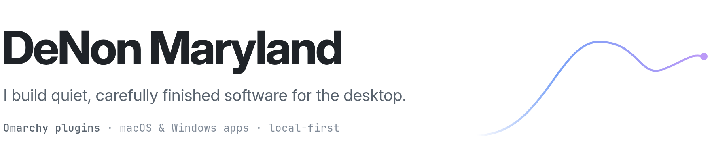

<picture>
  <source media="(prefers-color-scheme: dark)" srcset="assets/header-dark.png">
  <source media="(prefers-color-scheme: light)" srcset="assets/header-light.png">
  
</picture>

I make small desktop tools and keep working on them until they feel like part of the system: they follow your theme, stay out of the way, and are checked on real hardware before they ship. Most of my work runs on [Omarchy](https://omarchy.org), Arch Linux with Hyprland. Softly also ships for macOS and Windows.

### Projects

<a href="https://github.com/denonmaryland/omarchy-theme-studio"><picture><source media="(prefers-color-scheme: dark)" srcset="assets/theme-studio-dark.png"></picture></a>
<a href="https://github.com/denonmaryland/hello-lock"><picture><source media="(prefers-color-scheme: dark)" srcset="assets/hello-lock-dark.png"></picture></a>

<a href="https://github.com/denonmaryland/omarchy-tricky-tiles"><picture><source media="(prefers-color-scheme: dark)" srcset="assets/tricky-tiles-dark.png"></picture></a>
<a href="https://github.com/denonmaryland/softly"><picture><source media="(prefers-color-scheme: dark)" srcset="assets/softly-dark.png"></picture></a>

### How I build

- **Fit the desktop.** Every surface takes its colors from the active theme, so it looks like it shipped with the system.
- **Measure, don't eyeball.** Tricky Tiles' springs were recorded at 60 fps and fitted to within about 1% of the curve the panel draws.
- **Keep it local.** Softly runs Whisper on your machine. Your audio never leaves it.
- **Leave the critical path alone.** Hello Lock checks passwords with Omarchy's own code, line for line. The unlock animation starts only after the password is accepted, so it can never block you.

### Tools

QML / Quickshell · Python · Swift · C# / .NET · JavaScript · Lua · GLSL · Hyprland

