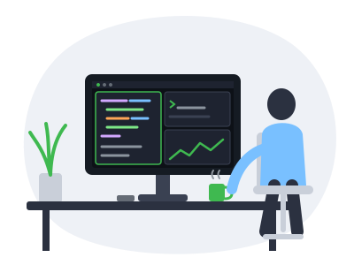
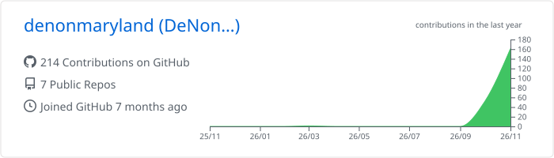
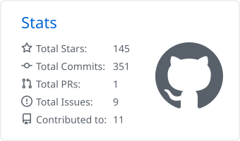
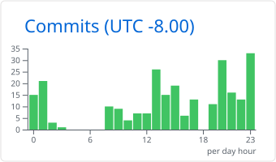
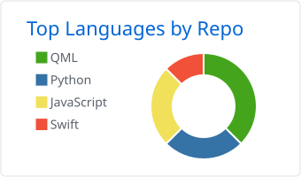
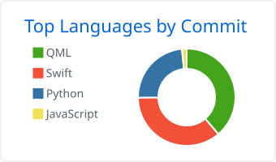
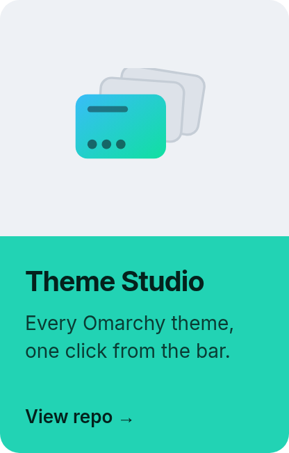
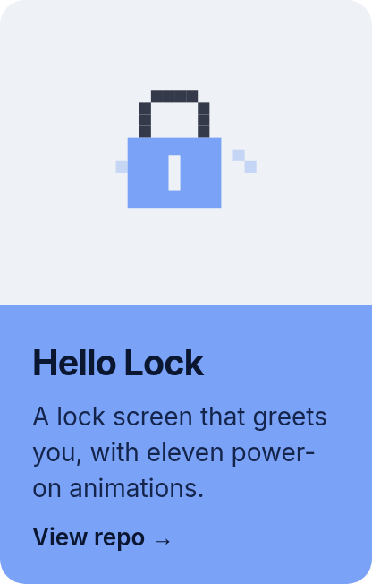
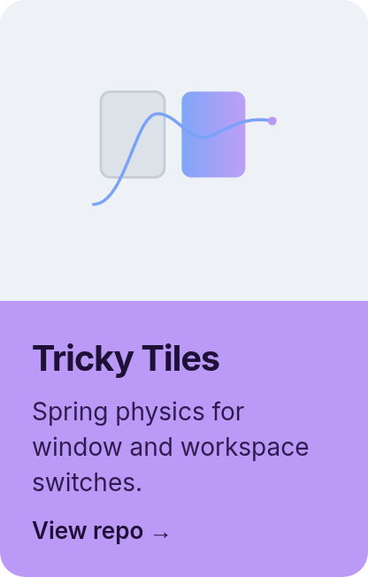
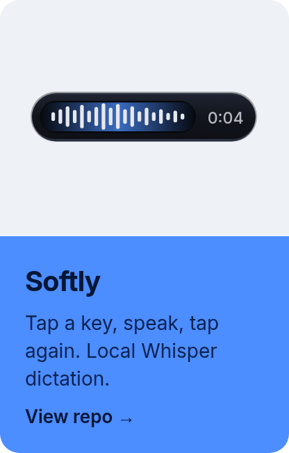

<h3 align="center">😎 Hey everyone, I'm DeNon</h3>

  

- 🖥️ Building small desktop tools that feel like part of the system
- 🎨 Every surface follows your theme, so it looks like it shipped with the OS
- 📏 Measured, not eyeballed: everything is checked on real hardware before it ships
- 🔒 Local first: Softly runs Whisper on your machine, your audio never leaves it
- 🤝 Open to collaboration on [Omarchy](https://omarchy.org) tooling

  

  
  
  

 

  <picture><source media="(prefers-color-scheme: dark)" srcset="profile-summary-card-output/github_dark/0-profile-details.svg"></picture>

  <picture><source media="(prefers-color-scheme: dark)" srcset="profile-summary-card-output/github_dark/3-stats.svg"></picture>
  <picture><source media="(prefers-color-scheme: dark)" srcset="profile-summary-card-output/github_dark/4-productive-time.svg"></picture>

  <picture><source media="(prefers-color-scheme: dark)" srcset="profile-summary-card-output/github_dark/1-repos-per-language.svg"></picture>
  <picture><source media="(prefers-color-scheme: dark)" srcset="profile-summary-card-output/github_dark/2-most-commit-language.svg"></picture>

  

### Projects

<a href="https://github.com/denonmaryland/omarchy-theme-studio"><picture><source media="(prefers-color-scheme: dark)" srcset="assets/theme-studio-dark.png"></picture></a>
<a href="https://github.com/denonmaryland/hello-lock"><picture><source media="(prefers-color-scheme: dark)" srcset="assets/hello-lock-dark.png"></picture></a>
<a href="https://github.com/denonmaryland/omarchy-tricky-tiles"><picture><source media="(prefers-color-scheme: dark)" srcset="assets/tricky-tiles-dark.png"></picture></a>
<a href="https://github.com/denonmaryland/softly"><picture><source media="(prefers-color-scheme: dark)" srcset="assets/softly-dark.png"></picture></a>

### How I build

- **Fit the desktop.** Every surface takes its colors from the active theme, so it looks like it shipped with the system.
- **Measure, don't eyeball.** Tricky Tiles' springs were recorded at 60 fps and fitted to within about 1% of the curve the panel draws.
- **Keep it local.** Softly runs Whisper on your machine. Your audio never leaves it.
- **Leave the critical path alone.** Hello Lock checks passwords with Omarchy's own code, line for line. The unlock animation starts only after the password is accepted, so it can never block you.

### Tools

QML / Quickshell · Python · Swift · C# / .NET · JavaScript · Lua · GLSL · Hyprland

